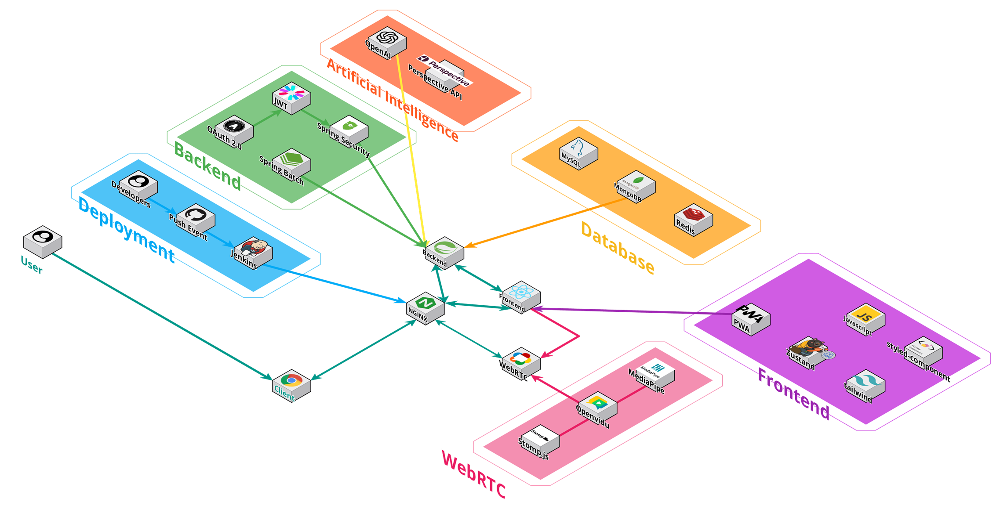
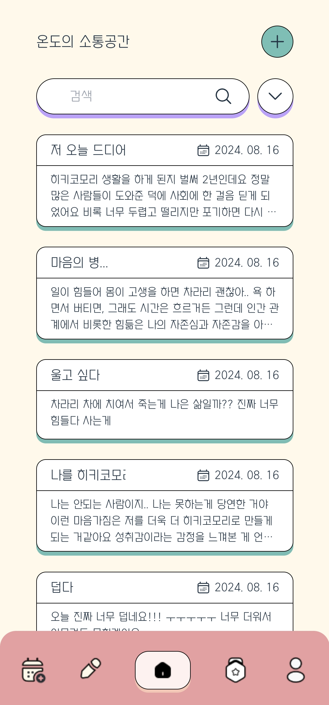
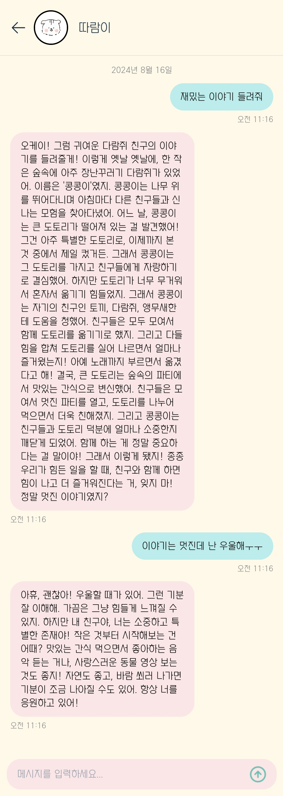
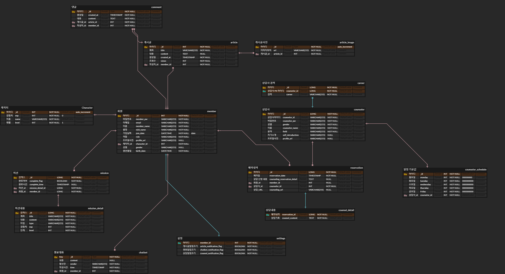
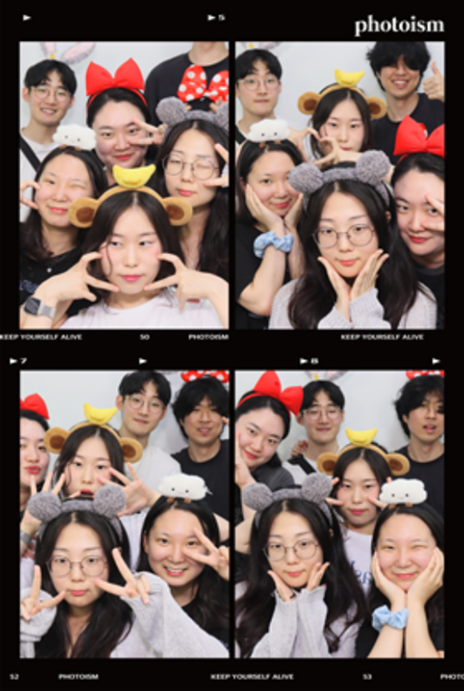

# Ondo

<div align="center">
  
</div>

## 🏆삼성 청년 SW아카데미(SSAFY) 11th 공통프로젝트🏆

## ✅ 프로젝트 진행 기간

2024.07.02 ~ 2024.08.16

## ✅ 멤버소개

<table>
<thead>
<tr>
<th style="text-align: center;"><strong>이예빈</strong></th>
<th style="text-align: center;"><strong>김성은</strong></th>
<th style="text-align: center;"><strong>김영빈</strong></th>
<th style="text-align: center;"><strong>이대현</strong></th>
<th style="text-align: center;"><strong>이예지</strong></th>
<th style="text-align: center;"><strong>정유진</strong></th>
</tr>
</thead>
<tbody>
<tr>
<td align="center"><a href="https://github.com/???"> <br> ???</a></td>
<td align="center"><a href="https://github.com/KSE0514"> <br> @KSE0514</a></td>
<td align="center"><a href="https://github.com/ybk1"> <br> @ybk1</a></td>
<td align="center"><a href="https://github.com/???"> <br> ???</a></td>
<td align="center"><a href="https://github.com/Sophia0705"> <br> @Sophia0705</a></td>
<td align="center"><a href="https://github.com/???"> <br> ???</a></td>
</tr>
<tr>
<td align="center"><b>팀장 | BE | FE</td>
<td align="center"><b>FE | DESIGN</td>
<td align="center"><b>BE</td>
<td align="center"><b>BE | INFRA</td>
<td align="center"><b>FE | DESIGN</td>
<td align="center"><b>BE </td>
</tr>
</tbody>
</table>

## ✅ 기술스택

<table>
    <tr>
        <td><b>Back-end</b></td>
        <td>    <br>    
</td>
    </tr>
    <tr>
    <td><b>Front-end</b></td>
    <td>
   <br>

  

  </td>
    </tr>
    <tr>
    <td><b>Infra</b></td>
  <td>

     

</td>
    <tr>
    <td><b>Tools</b></td>
    <td>
        
</table>

## ✅ 시스템 아키텍쳐



## ✅ 프로젝트 소개

▪️**서비스 목적**

▪️**서비스 목표**

▪️**기대효과**

## ✅ 기능 소개

<table>    
    <tr align="center"> 
        <td><strong> 게시판 </strong></td>
        <td><strong> 챗봇</strong></td>
    </tr>
    <tr align="center"> 
        <td>  </td>
        <td>  </td>
    </tr>
    <tr> 
        <td>
            1. 마음의 이야기를 털어놓을 수 있는 게시판 <br>
        </td>
        <td>
            1. 매일 일정 시간에 오는 챗봇을 통해 미션 알림<br>
            2. 평소에도 언제든 다람이와 채팅
        </td>
    </tr>
    <tr align="center"> 
        <td><strong>미션</strong></td>
        <td><strong>미션 완료</strong></td>
    </tr>
    <tr align="center"> 
        <td>  </td>
        <td>  </td>
    </tr>
    <tr> 
        <td >
            1. 매일 다람이가 주는 특별 미션(챗봇으로 알림)<br>
            2. 매일 간단한 일상 회복을 돕는 데일리 미션
        </td>
        <td>
            1. 미션 완료를 통해 포인트를 얻고, 다람이의 온도를 높일 수 있음
        </td>
    </tr>
</table>

## ✅ 활용기술, 기술 설명

- **다람이 Chat bot**

  1. OpenAI API를 활용해 마스코트와 대화하는 듯한 대화를 자동 생성
  2. 특정 사용자의 대화내용이 필요한 상황에서 MongoDB를 사용해 Document 단위로 조회하여 성능 개선

  ```java
  WebClient webClient = WebClient.builder().build();
  String url = "https://api.openai.com/v1/chat/completions";

  webClient.post()
    .uri(url)
    .header("Content-Type", "application/json")
    .header("Authorization", "Bearer " + api)
    .bodyValue(dto)
    .retrieve()
    .toEntity(ChatCompletion.class)
    .block();
  ```

- **알림**

  1. 주기적인 알림을 구현하기 위한 Scheduling 사용
  2. 대규모 사용자 처리를 위해 Spring Batch를 적용
  3. Firebase Cloud Message를 사용해 기기단위 알림 서비스 제공

  ```java
  private final String[] SCOPES = {"https://www.googleapis.com/auth/firebase.messaging"};

  public String getAccessToken() throws IOException {
  	ClassPathResource resource = new ClassPathResource("firebase.json");

  	GoogleCredentials googleCredentials = GoogleCredentials
  		.fromStream(resource.getInputStream())
  		.createScoped(Arrays.asList(SCOPES));
  	googleCredentials.refreshIfExpired();  // refreshIfExpired로 토큰 갱신
  	googleCredentials.refreshAccessToken();
  	return googleCredentials.getAccessToken().getTokenValue();
  }
  ```

- **회원**

  1. Spring Security를 사용한 회원 관리 기능 구현
  2. Redis를 사용한 Expire 유효 기간 설정
  3. 클라이언트의 Cookie에 토큰을 저장하고 사용하도록 구현

- **WebRTC**
  1. OpenVidu를 기반으로 한 상담사와의 실시간 화상 상담 기능 구현
  2. MediaPipe를 통해서 안면 인식을 하고 자동으로 캐릭터로 덧씌워주는 기능을 구현
  ```javascript
  const camera = new Camera(videoRef.current, {
    onFrame: async () => {
      await faceMesh.send({ image: videoRef.current });
    },
    width: 640,
    height: 480,
  });
  camera.start();
  ```

## ✅ 산출물(ERD, 명세서, 파일구조)

### ERD

<div style="display: flex; justify-content: space-between;">
    
</div>

### 명세서

- **요구사항, 기능 명세서**

  [https://www.notion.so/b7da75e62bba4010bb199bb8d6f3d63c?pvs=4](https://www.notion.so/b7da75e62bba4010bb199bb8d6f3d63c?pvs=4)

- **API 명세서**

  [https://www.notion.so/API-Reference-e67a43dfcf5c49e084a72192bebda2c6?pvs=4](https://www.notion.so/API-Reference-e67a43dfcf5c49e084a72192bebda2c6?pvs=4)

</details>

## ✅ 결과공유, 느낀점(모두작성)

이예빈:

김성은: React.JS 프로젝트는 처음이라 서툴렀지만, 많은 것을 배울 수 있었습니다. 특히 PWA로 앱과 비슷한 경험을 제공할 수 있다는 점이 인상 깊었습니다. UTC와 관련된 시간 차이 오류를 해결하며 시간 데이터 처리에 대해 배웠고, 요일별 일정 타임테이블 구현 중 출력 순서 문제도 해결해 작업 프로세스의 중요성을 깨달았습니다. 이번 경험은 기술적 성장과 문제 해결 역량을 키울 수 있었던 의미 있는 시간이었습니다.

김영빈:

이대현:

이예지: 일정관리와 기획의 중요성에 대해 많이 느꼈고, 다음 프로젝트를 하면서 일정 관리에 조금 더 신경쓰고 있습니다. 그래도 처음이라 모든 게 어려울 때, 팀원들이 다 같이 도와줘서 기술적으로도 팀 프로젝트라는 관점에서도 배우는 게 많았습니다.

정유진:

## ✅ ❤온도팀 사진❤


