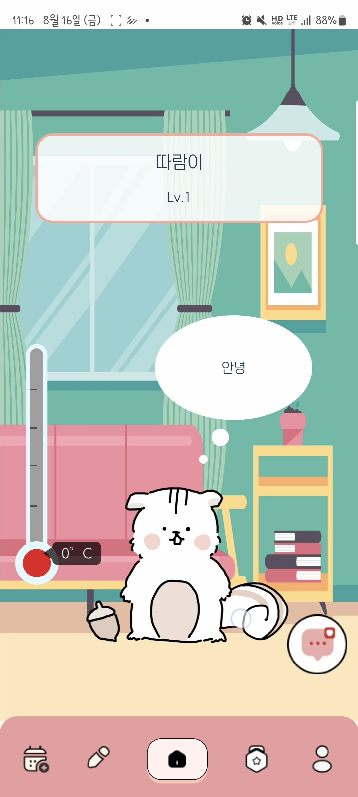
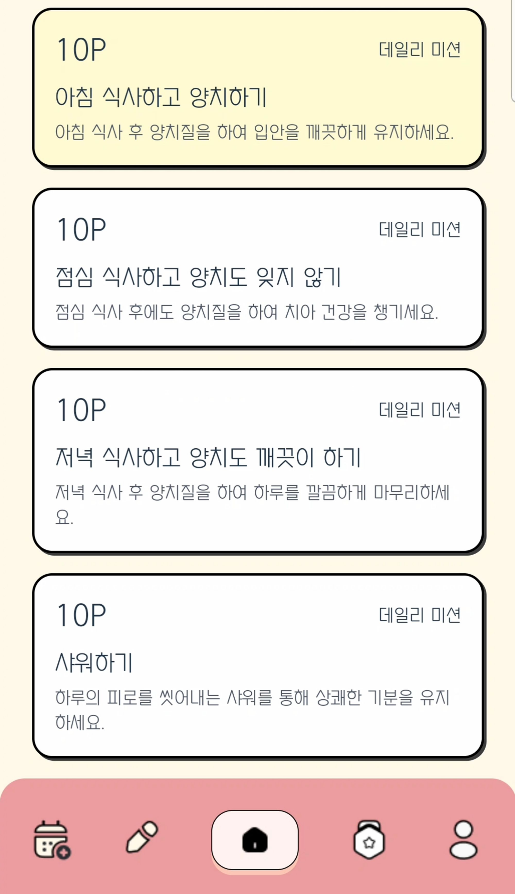
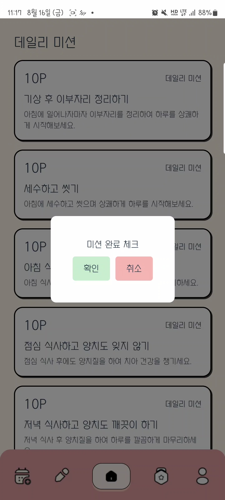
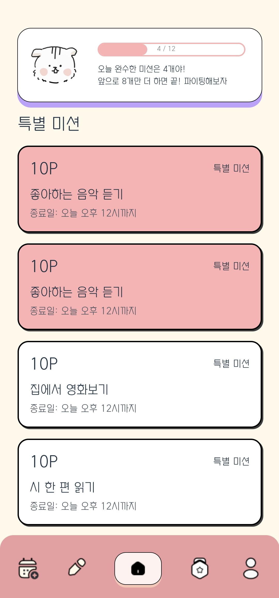
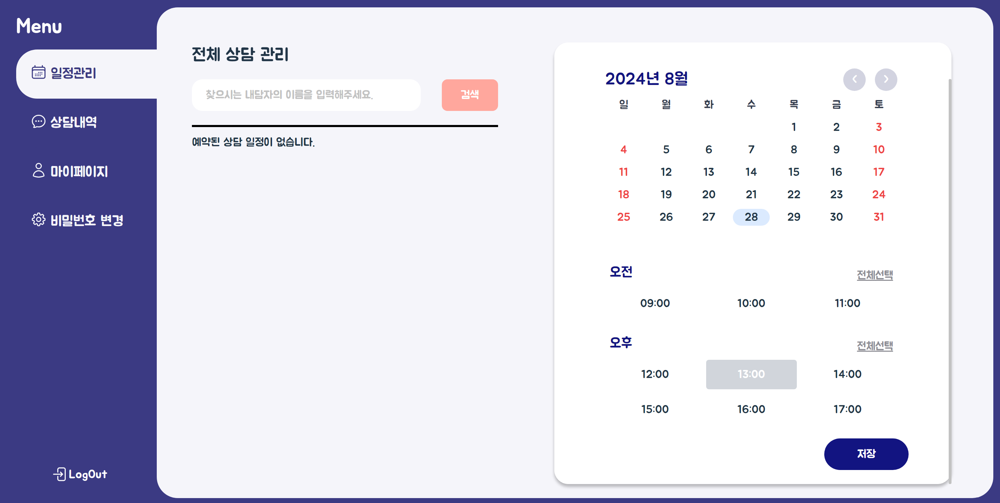
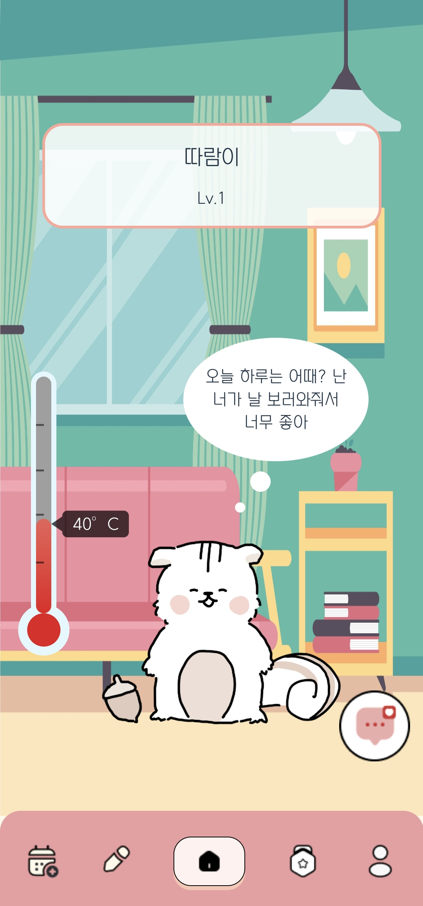

# 시연 시나리오 정리본

## 내담자 대현씨의 하루

### 아침 일과

1. 대현씨가 아침에 일어나 "온도" 서비스에 접속해 자신의 캐릭터 "다람이"를 만난다.
    - 캐릭터 만지기 기능 사용

1. 다람이가 보낸 오늘의 미션 메시지를 확인하기 위해 채팅창으로 이동한다.
2. 기분이 우울한 대현씨는 "다람이"에게 재밌는 이야기를 들려달라고 부탁한다.
    - 챗봇에게 채팅 보내기 기능 사용

1. 다람이에게서 응원의 메시지가 도착하자 대현씨의 기분이 좋아진다.

### 미션 수행

1. 대현씨는 매일 달라지는 미션을 확인하고 실천하기로 한다.
    - 미션창으로 이동

1. 대현씨는 특별미션이나 데일리미션 중 하나를 선택해 수행한다.
    - 예: 산책, 책 읽기, 영화 보기 등

### 미션 완료 및 보상

1. 미션을 완료한 대현씨는 완료 버튼을 눌러 이를 기록한다.
2. 완료 버튼을 누르자 미션 게이지가 차오르고, 홈 화면으로 이동하니 캐릭터의 온도가 올라갔다.
3. 대현씨는 뿌듯함을 느낀다.

## 상담사 성은씨의 하루

### 상담 일정 관리

1. 상담사 성은씨는 상담 일정을 조정 중이다.
    - 상세 일정 조정 기능 사용
    
    
    
2. 급작스러운 일정으로 인해 당일 오후 상담 예약을 막아둔다.
3. 매주 화요일에 잡혀있던 강연이 마무리되어, 해당 시간에 상담을 이어가기로 한다.
    - 요일별 일정 조정 기능 사용
    
    
    

### 상담 준비 및 진행

1. 상담사는 당일 예약된 내담자의 정보를 확인한다.
2. 상담 환경 점검을 위해 채팅을 테스트하고 기록지를 확인한다.
3. 내담자 대현씨가 상담방에 입장하자 성은 상담사는 상담을 진행한다.

### 상담 종료 후 업무

1. 상담이 종료되자 성은 상담사는 상담방에서 나온다.
2. 상담 내용을 잊지 않기 위해 메모를 남기고, 내담자 정보를 수정한다.

## 대현씨의 저녁 시간

### 미션 완료 및 레벨 업

1. 저녁이 되어 미션 완료를 한 대현씨는 오늘의 미션을 모두 완료했음을 확인한다.
2. 홈 화면으로 이동해보니 대현씨의 레벨이 올랐다.

### 커뮤니티 활동

1. 기쁜 마음에 커뮤니티 게시판에 글을 올리려 하지만, 욕설이 포함되어 필터링된다.
    - 비속어 필터링 기능 적용
2. 대현씨는 욕설 없이 글을 다시 작성해 올린다.

## 마무리

- 생활 루틴에 맞춰 하루를 보낸 대현씨는 보람찬 하루를 마무리한다.
- 내일도 열심히 하겠다는 다짐을 한다.
- 이러한 과정을 통해 대현씨는 망가진 생활 패턴을 개선하고 동기부여를 얻게 된다.